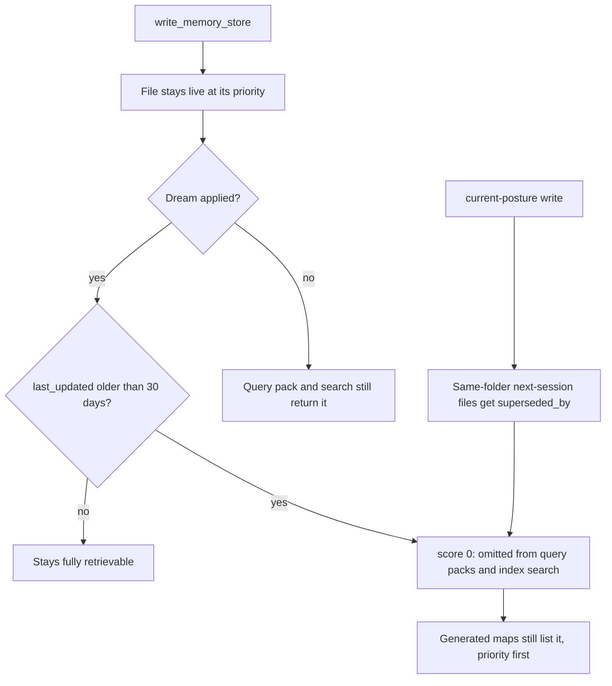

# How outdated memory is handled

Age is not a truth value. An old memory can still be the rule, and a new memory can already be false. The retriever uses `last_updated` anyway, so the notes people stop editing (stable decisions) disappear first, and the notes people keep editing (handoffs, incidents, journals) stay in front with their dead sentences still inside.

A fact leaves the pack only when Dreaming has applied `review_status: stale` (or `broken-evidence`), or when something has written `superseded_by`. Both are retrieval switches. They do not record what replaced the fact, and they do not run on write.

Age decay in ranking is mild and never removes a file by itself. Default half-life is 90 days with a floor of 0.3 ([ranking.py](src/memory_fabric/storage/ranking.py)). A high-priority note three months old still outranks a new medium note on the same keywords. Handoff filenames use a 14-day half-life, which only reorders them.

The 30-day hard hide is in the dream finalizer, not on the read path ([finalize.py](src/memory_fabric/storage/finalize.py) around the staleness loop). Query packing and index search then multiply by `review_status_penalty` / `superseded_penalty` and drop a score of 0 ([context.py](src/memory_fabric/storage/context.py), [search.py](src/memory_fabric/storage/search.py)). `read_memory_store_tool` still returns the full body and does not mention the flag.

`superseded_by` is applied automatically only to `*next-session*` files in the same top-level folder as a `current-posture` file ([hygiene.py](src/memory_fabric/storage/hygiene.py)). Contradiction detection lists conflicts and never writes that field ([contradictions.py](src/memory_fabric/storage/contradictions.py)). The roadmap item that would mark contradicted facts superseded (`valid_from` / temporal facts in [ROADMAP.md](ROADMAP.md)) is still open. Session journals are not rolled up; the "older than 7 days" line in [journal.py](src/memory_fabric/storage/journal.py) is not what deep dream does. Deep dream only folds `episodic/commits/` after 14 days.

## What the other stores actually do

Counted on 2026-11-18, ignoring `private/`, `snapshots/`, `evals/`, `candidates/`, and `consolidated_memory.md`.

- **search-sermons** (430 store files, dream index touched today): 206 stale, 17 `superseded_by` (all fine-tuning `next-session` siblings of `fine-tuning/current-posture-2026-10-31`). Every file older than 30 days is hidden. 131 files are still `priority: high`. Index frontmatter says `contradiction_count: 50` and shows four truncated lines, including polarity hits on `lora`.
- **search-sermons-qa-quote-fix**: 115 stale, 109 files older than 30 days still live, 0 `superseded_by`, 116 of 232 files high.
- **GamePilgrimProgress**: 16 stale, 24 files older than 30 days still live, 0 `superseded_by`, 17 high files older than 60 days still live. `architecture/decisions/phaser4-migration` is stale even though the body is the current renderer decision.
- **tcc** and **projeto1**: no `review_status` and no `superseded_by` at all. tcc has 12 decision files, 13 high files older than 60 days, last touched around 2026-08-15. Doctor only warns when every file under `decisions/` is stale, so this store stays quiet.
- **This repo**: 37 stale, 0 `superseded_by`, 24 files older than 30 days still live, 38 of 76 files high. Steering `framework-rules` and `ubiquitous-language` are stale (last update June). `debt/read-path-retrieval-defects` is high, dated 2026-08-15, and describes v1.2.0 bugs that later journals say were fixed. It has no `superseded_by`.

Two regimes, split by whether anyone applies a dream:

- Dreamed store (search-sermons): untouched history disappears on the query path, including decisions that are still true, unless a later edit or a dream rewrite bumps `last_updated`.
- Undreamed store (tcc, projeto1, and the leftover live files here): retired notes stay high and come back on the next keyword hit.

## Age is not truth

`last_updated` records the last edit. A fact stays true until some later fact closes it, and a fact can be false on the day it is written. The four combinations all show up in these stores:

- **Old and still true.** tcc `decisions/lab-only-sem-prontuario` (2026-08-15) locks the study to lab reports and forbids chart review. Nobody has had to edit it, so it is 94 days old. GamePilgrim `architecture/decisions/phaser4-migration` (2026-07-10) is the renderer the game still uses, and dream has marked it stale. This repo's `framework-rules` still says Python >= 3.11; the memory pack now omits that body because the file was last edited in June.
- **Old and no longer true.** `debt/read-path-retrieval-defects` (2026-08-15, priority high) describes v1.2.0 bugs that later journals say were fixed. It has no `superseded_by`. Age did not retire it, and a dream that only checks age would hide it for the same reason it hides the lab-only rule.
- **New and still true.** The newest paragraph of a posture or a decision that was reversed on purpose. This is the only cell the age rules treat correctly, and only while that paragraph is the whole file.
- **New and already false.** One file can be the newest object in the store and still contain dead sentences. `fine-tuning/current-posture-2026-10-31` is pinned into every search-sermons pack. Its `last_updated` is 2026-11-16. Inside it, the October section says the next GPU job is a RAG refusal re-SFT and says not to resume the OT chase. A later section the same file, dated 2026-11-12, says the next session is OT fine-tune and that the chase freeze is lifted. A 2026-11-13 section then points the next OT step at `fine-tuning/next-session-ot-probe-ooc-candidates`. Dream has stamped that target, and the earlier next-session files, with `superseded_by` pointing back at this posture. The pinned "live" page still gives the agent all three next-steps. The file is new. The earlier sentences are not.

The write clock runs backwards from durability. A locked decision is edited least, so it becomes the oldest file and is the first thing a dream hides. A handoff, an incident note, and a session journal are edited most, so they stay the newest and win ranking. Dream makes this worse when a body rewrite sets `last_updated` to now and clears `review_status` ([finalize.py](src/memory_fabric/storage/finalize.py)): a paraphrase of a dead fact becomes the freshest copy.

Truth here is per sentence, and the machinery is per file. Appending an update to a posture keeps every earlier "next session" line in the same document, under one fresh timestamp. `sft-weighted-live-train-destroyed-2026-10-16` was true for minutes (the instance was destroyed at 21:47Z) and already contained its own fix the next morning; the whole file is now stale, so the expired "do not rent" warning and the still-relevant probe fix disappear together.

What would track truth is a close event: this sentence ended because that later sentence replaced it. Age never produces that event. A new write never produces it either, unless the writer sets `superseded_by` or the path happens to match the next-session rule.

## Problems

**The hide has no successor.** After the stamp, query packs and index search omit the file. Maps do not. [maps.py](src/memory_fabric/storage/maps.py) sorts by priority and prints title plus summary for every file, stale or superseded. Startup with no query is maps-first, so the table of contents still leads with those summaries. There is no link to the note that replaced the hidden one, except the handoff special case.

**The handoff special case misses the other "start here" files.** Demotion stays inside one top-level folder. search-sermons hides fine-tuning `next-session` files and still keeps `pretraining/cpt-next-session-handoff`, whose body says "Superseded pointer (2026-10-23)" and whose frontmatter has no `superseded_by`. It was updated 2026-10-23, so it is inside the 30-day window and still ranks as a handoff (`next-session` uses the 14-day half-life, which keeps a recent file strong). Nine search-sermons store files say "superseded" in the opening and have no field. `pretraining/next-session-cpt-improve` was touched 2026-11-16, the same timestamp as the fine-tuning posture, so CPT and SFT each have a live "start here".

**Contradiction review does not change what is retrieved.** Hits are advisory. The scan loads files in sorted path order and stops at 150 ([contradictions.py](src/memory_fabric/storage/contradictions.py)). In search-sermons that window is filled by `architecture`, `bugs`, `debt`, `decisions`, and most of `fine-tuning`. `pretraining` (113 files), `grok`, `ops`, and `schemas` are never compared. Episodic journals and failures are skipped on purpose. At most 50 hits are kept, and the index shows 5 of them, trimmed to about 150 tokens. The lines in today's search-sermons index are cut off mid-sentence ("cover similar content but state"). Successive `sN` / `vN` paths are treated as evolution, so an old number and its replacement often produce no hit. A small local model is already known to miss a planted TTL conflict (README note on the dream prompt).

**Several read paths put the old text back.**

- This session's own pack, queried for outdated memory, included the full v1.2.0 defect note and the August "Cursor hooks are held" decision, then truncated the later journals that correct them. Those files are not stale, so the ranker treated them as current high-priority architecture.
- Synced agent rules are a second copy. Here, Cursor's always-on rules still contain the full June steering text, while the memory pack replaced that body with "[stale steering — full body omitted; refresh content or clear review_status]". One channel hides the text. The other injects it with no stale banner. The stub tells the agent it may clear the flag.
- `keyword_search` via the SQLite index drops score 0. The ripgrep fallback ranks stale files last and can still return them. `read_memory_store_tool` always returns the body.
- `consolidated_memory.md` in search-sermons is a large extra copy full of stale sections and pointers at old handoff paths. Context assembly ignores it; a file read does not.

**Priority inflation keeps the old note in front until the hard hide.** Threshold is 24 high files, or half the store ([hygiene.py](src/memory_fabric/storage/hygiene.py)). search-sermons has 131 high. This repo has 38 of 76. tcc has 18 of 24. A warning on write does not demote the existing pile. Eval can fail `priority_inflation`; that does not change the pack.

**History has nowhere to go.** search-sermons keeps 67 episodic files and 61 failure files. They are skipped by the contradiction scan. Only commit-capture dailies roll up, and only on deep dream. Old session journals stay in the store and, until a dream stamps them, they match keywords and spend the budget (this pack used about 3,300 tokens on episodic files).

## What this makes hard for an agent

- On a store that has not been dreamed lately, the confident high-priority note is often the retired one. The later correction is a low-priority journal, easy to truncate.
- On a store that has been dreamed, a still-true decision older than 30 days is absent from search. tcc's "lab-only, no chart review" would vanish after one dream and stay gone until someone edits it. The newest handoff is what remains, including sentences that a later paragraph in the same file already reversed.
- A fresh `last_updated` on a pinned posture keeps the dead "next session" lines in the pack. search-sermons pins `current-posture-2026-10-31` (touched 2026-11-16) with three successive next-steps still in the body, while the files those steps name are marked superseded by the posture itself.
- Nothing in the pack says which of two matching files won. The index contradiction lines are too short to act on, and they are not wired to `superseded_by`.
- Filename tricks (`current-posture`, `next-session`, `*-complete`, `*-v2-*`) are the only automatic lifecycle. A normal decision, bug, or schema note never gets a successor pointer, even when the body says it was replaced.
- Clearing `review_status` or rewriting the summary is enough to make a dead fact look maintained. The dream prompt asks the model to clean stale files and, in the same prompt, not to choose a winner.

No code change is proposed here. A fact needs a close event the retriever can see: which later sentence ended this one. `last_updated` cannot supply that event, because old files stay true and new files are often already false.
